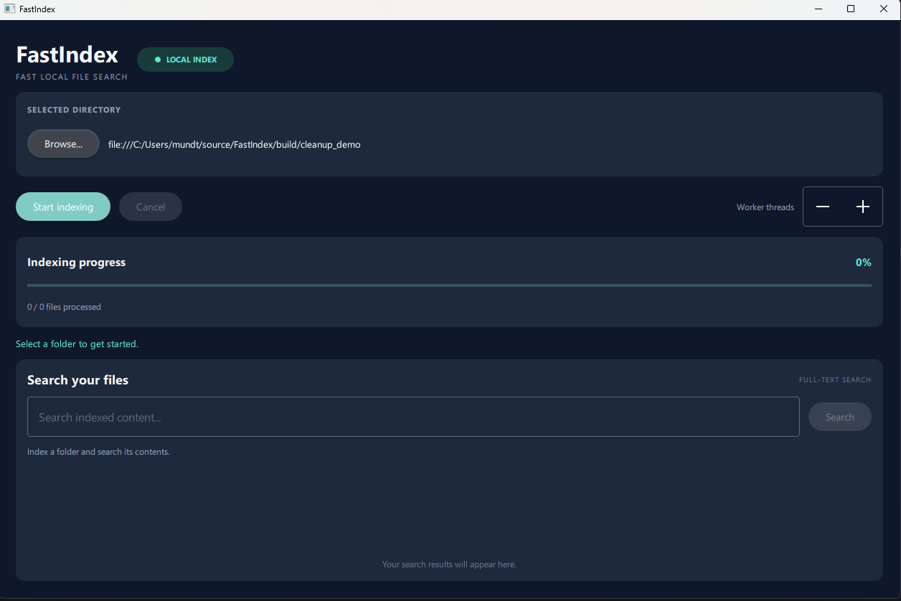

# FastIndex

[](https://github.com/JonasMundt/FastIndex/actions/workflows/windows-ci.yml)

**Fast local file indexing and full-text search, built with C++20, Qt 6, and SQLite FTS5.**

FastIndex is a desktop application that scans selected directories, indexes supported text files in a persistent local SQLite database, and lets you search their contents through a Qt Quick interface. File reading runs concurrently while a single database writer commits indexed content in batches.

> **Project status:** Working prototype. Windows builds and automated tests run in GitHub Actions; packaging and additional cross-platform validation are planned.



## Features

- **Recursive indexing:** Scan `.txt`, `.md`, `.csv`, and `.log` files in a selected directory.
- **Parallel processing:** Configure **1–16 reader workers**, implemented with C++20 `std::jthread`, stop tokens, and a bounded producer-consumer queue.
- **Persistent full-text search:** SQLite **FTS5** provides indexed queries and matching text snippets; click a result to open the file in its default application.
- **Responsive desktop UI:** A Qt 6 / QML interface with progress reporting, cancellation, and search results.
- **Saved preferences:** Remember the last selected folder and worker count using Qt `QSettings`.
- **Incremental updates and cleanup:** Reindexing updates file content; after a successful GUI indexing run, missing files in that directory are removed from the index.
- **Defensive file handling:** Size-limited file reads (10 MiB per file by default), transactional SQLite writes, and tests for cancellation and rollback.

All indexed content is stored **locally**; FastIndex does not require a cloud search service.

## Architecture

```text
Qt Quick / QML desktop UI
          |
          v
   IndexingController
          |
          v
ParallelIndexingService
          |
          +--> FileScanner (recursive discovery)
          |
          +--> Reader workers (std::jthread)
          |         |
          |         v
          |   Bounded BlockingQueue
          |         |
          |         v
          +--> Single SQLite writer
                    |
                    v
              SQLite + FTS5
                    |
                    v
              Search results
```

The design separates file discovery and reading (`fastindex_core`), SQLite persistence and search (`fastindex_storage`), and indexing orchestration (`fastindex_indexing`). A single writer prevents simultaneous SQLite writes from competing worker threads. Writes are grouped in batches of 100 to reduce transaction overhead.

### Technology stack

| Component | Technology |
| --- | --- |
| Language | C++20, with C17 SQLite amalgamation |
| Desktop interface | Qt 6, Qt Quick, QML, Qt Quick Controls |
| Search and persistence | SQLite with FTS5 |
| Concurrency | `std::jthread`, `std::stop_token`, atomics, bounded blocking queue |
| Build system | CMake |
| Automated testing | GoogleTest, CTest |
| CI | GitHub Actions (Windows / MSVC 2022) |
| Benchmarking | PowerShell runner and recorded CSV results |

## Build from source (Windows)

### Prerequisites

- Windows 10/11 and **Visual Studio 2022** with the C++ desktop development tools
- **CMake 3.21+**
- **Qt 6.10+** built for **MSVC 2022 x64** (developed locally with Qt 6.12.0)
- Git and an internet connection on the first build to fetch GoogleTest

From a terminal in the project directory, configure a separate Visual Studio build:

```cmd
cmake -S . -B build -G "Visual Studio 17 2022" -A x64 -DCMAKE_PREFIX_PATH="C:/Qt/6.12.0/msvc2022_64"
cmake --build build --config Release --parallel
ctest --test-dir build -C Release --output-on-failure
```

To launch the desktop app from that Release build:

```cmd
set "PATH=C:\Qt\6.12.0\msvc2022_64\bin;%PATH%"
build\Release\FastIndex.exe
```

Adjust the Qt path to your installation. The commands above use the Visual Studio multi-configuration generator; a Ninja build may place the executable directly in `build\` instead. A standalone packaged download is not yet available.

## Command-line interface

FastIndex also provides a CLI for indexing and searching without the GUI:

```cmd
build\Release\fastindex_cli.exe index "C:\Documents" "C:\Temp\fastindex.db" --parallel 4
build\Release\fastindex_cli.exe search "C:\Temp\fastindex.db" FastIndex
```

The CLI database path is explicit; the desktop app maintains its own database in the platform's application-data directory.

## Testing and benchmarks

The project currently has **34 GoogleTests** covering file scanning, file reading, SQLite indexing and transactions, sequential and parallel indexing, the blocking queue, cancellation, and deleted-file cleanup.

```cmd
ctest --test-dir build -C Release --output-on-failure
```

The [Windows CI workflow](.github/workflows/windows-ci.yml) configures a clean MSVC 2022 environment, builds the project in Release mode, and runs the test suite on pushes and pull requests.

### Performance experiments

Benchmark scripts and results live in [`benchmarks/`](benchmarks/), including the [batched-write results](benchmarks/results/batch_100_release.csv). The recorded local experiment indexed 1,000 small synthetic text files, with nine runs per configuration:

| Configuration | Median indexing time |
| --- | ---: |
| Sequential | ~295 ms |
| Parallel, 1 worker | ~231 ms |
| Parallel, 2 workers | ~347 ms |
| Parallel, 4 workers | ~201 ms |
| Parallel, 8 workers | ~440 ms |

These are **machine- and workload-specific measurements**, not guaranteed performance results. Small-file I/O, scheduling, caching, and database overhead can outweigh additional parallelism; more threads are not always faster.

## Current limitations and next steps

- Index updates are **manual**; there is no filesystem watcher yet.
- Only the supported text extensions are scanned; binary formats and document extraction are out of scope.
- Search currently displays the first 100 matching results, and query pagination is not implemented.
- Additional text-encoding validation, error-path tests, and Linux CI are planned.
- A self-contained Windows release package is planned; for now, build from source.

## License

No license has been added yet. The source is publicly viewable, but reuse permissions have not been granted through an open-source license.
